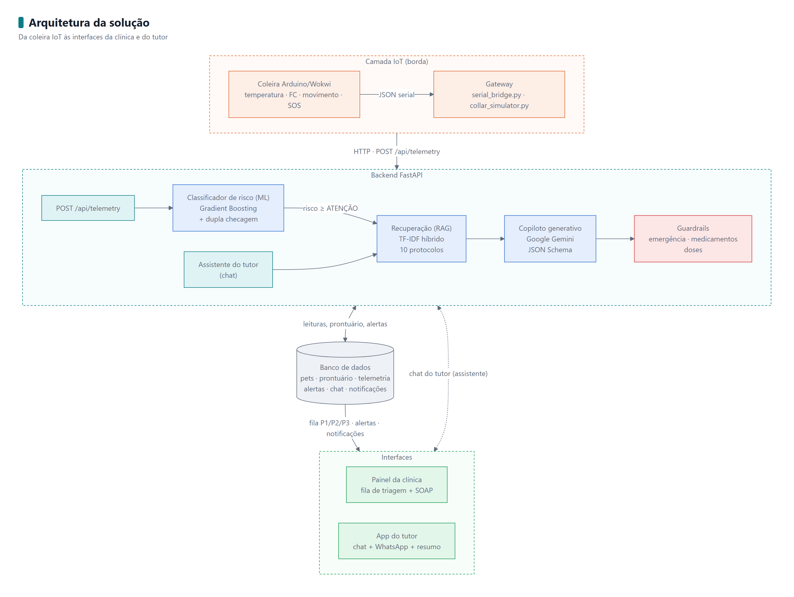
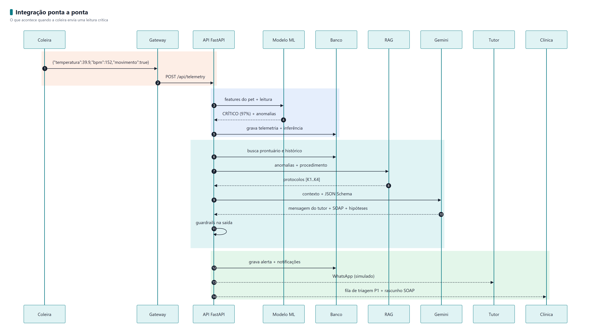

# CLYVO VET — Coleira Inteligente com IA Generativa (Sprint 4)

[](https://www.python.org/)
[](https://fastapi.tiangolo.com/)
[](https://scikit-learn.org/)
[](https://aistudio.google.com/)
[](https://wokwi.com/)
[](#9-testes-e-validação)

Repositório da **4ª Sprint** da disciplina **Disruptive Architectures: IoT, IoB & Generative AI** (FIAP). Nesta entrega, a solução de IA **especificada na Sprint 3** foi **implementada e integrada** à aplicação da CLYVO VET: a telemetria da coleira chega a uma **API REST**, é persistida em **banco de dados**, classificada por um **modelo de Machine Learning** e, quando há risco, um **copiloto com IA Generativa (LLM + RAG)** escreve o alerta para o tutor e o rascunho clínico SOAP para a equipe veterinária. O tutor ainda conta com um **assistente conversacional** e um **resumo diário personalizado**.

---

## 👥 Integrantes

| Nome | RM |
| :--- | :--- |
| Kaiky Pereira Rodrigues da Silva | RM 564578 |
| Gabriel Costa Solano | RM 562325 |
| Leandro Guarido de Oliveira | RM 561760 |

- **Vídeo pitch (YouTube, não listado):** _adicionar link_
- **Sprint 3 (entrega anterior):** <https://github.com/rodrigueszkkk/Sprint03-IOT>
- **Simulação Wokwi:** <https://wokwi.com/projects/475084250105444353>

---

## 📋 Sumário

1. [O que mudou da Sprint 3 para a Sprint 4](#1-o-que-mudou-da-sprint-3-para-a-sprint-4)
2. [Arquitetura](#2-arquitetura)
3. [Funcionalidades de IA implementadas](#3-funcionalidades-de-ia-implementadas)
4. [Integração: interface, banco, APIs e IA](#4-integração-interface-banco-apis-e-ia)
5. [Dados: preparação e validação](#5-dados-preparação-e-validação)
6. [Tecnologias utilizadas](#6-tecnologias-utilizadas)
7. [Como executar](#7-como-executar)
8. [Roteiro de demonstração](#8-roteiro-de-demonstração)
9. [Testes e validação](#9-testes-e-validação)
10. [Resultados](#10-resultados)
11. [Como a IA personaliza a experiência do tutor](#11-como-a-ia-personaliza-a-experiência-do-tutor)
12. [Estrutura do repositório](#12-estrutura-do-repositório)
13. [Limitações e próximos passos](#13-limitações-e-próximos-passos)

---

## 1. O que mudou da Sprint 3 para a Sprint 4

| Componente | Sprint 3 (especificação/protótipo) | Sprint 4 (implementado e integrado) |
| :--- | :--- | :--- |
| Coleira IoT (Wokwi) | Firmware emitindo JSON no Monitor Serial | Mesmo firmware, agora com `deviceId`, ligado à API pela **ponte serial** (`gateway/serial_bridge.py`) |
| Classificador de risco | Random Forest treinado com 20 linhas a cada execução | Dataset de **4.000 leituras**, comparação de **4 algoritmos** com validação cruzada, modelo persistido, **explicabilidade** e **dupla checagem clínica** |
| IA Generativa | Mensagens fixas em templates (`if/else`) | **LLM real (Google Gemini, via Google AI Studio)** com **RAG** sobre 10 protocolos clínicos + prontuário, **saída estruturada (JSON Schema)** e **guardrails** |
| Banco de dados | Dicionários em memória simulando o MySQL | **SQLite** com 7 tabelas (schema equivalente para MySQL em `database/schema_mysql.sql`) |
| API | Inexistente | **FastAPI** com 14 endpoints e Swagger em `/docs` |
| Interface | Simulador HTML isolado | **Painel web** integrado: triagem da clínica, app do tutor (chat + WhatsApp + resumo) e simulador |
| Assistente do tutor | Não existia | **Agente conversacional** com memória de conversa, contexto do pet e escalonamento automático de emergências |
| Testes | Nenhum | **38 testes automatizados** + script de avaliação que gera `docs/RESULTADOS.md` |

---

## 2. Arquitetura

<p align="center">
  
</p>

Fluxos detalhados (telemetria e chat), modelo de dados e decisões de projeto em [`docs/ARQUITETURA.md`](docs/ARQUITETURA.md). O diagrama conceitual da Sprint 3 continua em [`assets/iot_ai_architecture.png`](assets/iot_ai_architecture.png).

> As imagens dos diagramas ficam em `assets/diagramas/`. As fontes editáveis (Mermaid) estão em `assets/diagramas/fonte/`; depois de alterar alguma, gere as imagens de novo com `python assets/diagramas/gerar_diagramas.py` (requer `pip install playwright` e o Edge ou o Chrome instalado).

---

## 3. Funcionalidades de IA implementadas

### 3.1 Classificação preditiva de risco vital (Machine Learning supervisionado)
- **Entrada:** espécie, idade, se está em pós-operatório, dias desde a cirurgia, temperatura, frequência cardíaca, nível de atividade e botão SOS, mais 2 variáveis derivadas (FC normalizada pelos limites da espécie).
- **Treino:** Regressão Logística, Árvore de Decisão, Random Forest e Gradient Boosting comparados por **validação cruzada estratificada (5 folds, F1-macro)**; o melhor (**Gradient Boosting**) é avaliado em holdout de 25% e salvo em `models/risk_model.joblib`.
- **Saída:** nível (**ESTÁVEL / ATENÇÃO / CRÍTICO**), prioridade de triagem (P3/P2/P1), probabilidade de cada classe e **anomalias que justificam a decisão** (explicabilidade).
- **Dupla checagem de segurança:** o SOS e os limites críticos do protocolo (ex.: T > 40 °C, T < 37 °C, bradicardia acentuada) **nunca** são rebaixados pelo modelo. Isso eleva o recall da classe CRÍTICO de 85,9% (modelo puro) para **91,7%**.
- Código: [`app/services/risk_model.py`](app/services/risk_model.py), [`app/services/clinical_rules.py`](app/services/clinical_rules.py).

### 3.2 Copiloto Clínico com IA Generativa (LLM + RAG)
Quando o risco sobe, o copiloto monta um contexto com **quatro fontes**: perfil do pet, **prontuário** (SQL), **tendência das últimas leituras** e **protocolos clínicos recuperados** por busca semântica (identificados como `[K1]`, `[K2]`…). O LLM devolve, em **JSON validado por schema**:
- `tutor_message`: mensagem de WhatsApp acolhedora, com o nome do tutor e do pet, passos do que fazer e do que **não** fazer;
- `soap`: rascunho **S**ubjetivo / **O**bjetivo / **A**valiação / **P**lano para o veterinário;
- `hipoteses` em ordem de probabilidade e `citacoes` dos protocolos usados.

Código: [`app/services/copilot.py`](app/services/copilot.py), [`app/services/llm_client.py`](app/services/llm_client.py), [`app/services/knowledge_base.py`](app/services/knowledge_base.py).

### 3.3 Assistente conversacional do tutor
Chat no app do tutor que responde dúvidas sobre a recuperação **usando o contexto daquele pet** (fase pós-operatória, prescrição, últimas leituras da coleira) e os protocolos recuperados, com memória das últimas mensagens. Código: [`app/services/chat_agent.py`](app/services/chat_agent.py).

### 3.4 Resumo diário personalizado
`GET /api/pets/{id}/summary` agrega as leituras das últimas 24 h (faixa de temperatura, FC média, % do tempo em repouso, alertas) e a IA escreve um resumo com recomendações específicas para a fase da recuperação do pet.

### 3.5 Guardrails (IA responsável)
- **Emergência no chat** (convulsão, sangramento, pontos abertos, gengiva roxa…) → resposta imediata **sem passar pelo LLM** e **alerta P1 automático** para a clínica.
- **Medicamento humano** (paracetamol, ibuprofeno, dipirona…) → resposta segura padronizada, com aviso específico para gatos.
- **Saída do LLM:** qualquer dose que **não esteja na prescrição do prontuário** é removida e substituída por `[dose definida pelo veterinário]`; toda mensagem leva o aviso de que a IA não substitui o veterinário.
- **Anti-spam:** não repete alerta do mesmo nível em 5 min, **exceto** se o quadro piorar (anomalia nova) ou houver SOS.

Código: [`app/services/guardrails.py`](app/services/guardrails.py).

### 3.6 LLM: Google Gemini (Google AI Studio)
A IA generativa usa o **Gemini** pela API do **Google AI Studio**, que tem **plano gratuito** para testes. A chave `GEMINI_API_KEY` é **obrigatória**: sem ela, a aplicação não sobe e mostra como gerar a chave.

| Modo | Quando | Comportamento |
| :--- | :--- | :--- |
| `gemini` (padrão) | `GEMINI_API_KEY` no `.env` | Gemini (`gemini-flash-latest` por padrão) com saída estruturada por JSON Schema |
| contingência | O Gemini falha numa chamada (cota gratuita esgotada, rede, erro) | Só aquele alerta é gerado pelo gerador determinístico, no **mesmo formato**, para o tutor não ficar sem aviso |
| `offline` | `CLYVO_LLM_PROVIDER=offline` (escolha explícita) | Sem IA online; usado nos testes automatizados |

O modo em uso aparece no topo do painel e em cada alerta (`llm_mode`).

---

## 4. Integração: interface, banco, APIs e IA

<p align="center">
  
</p>

### Endpoints principais (documentação completa em `http://localhost:8000/docs`)

| Método | Rota | Função |
| :--- | :--- | :--- |
| `POST` | `/api/telemetry` | Recebe leitura da coleira (aceita o JSON do firmware Wokwi ou o formato da API) e executa o pipeline |
| `POST` | `/api/simulate/{cenario}` | Cenários de demonstração: `normal`, `atencao`, `critico`, `sos`, `hipotermia`, `febre_progressiva` |
| `GET` | `/api/triage` | Fila de triagem ordenada por prioridade |
| `GET` | `/api/alerts` · `PATCH /api/alerts/{id}/ack` | Alertas gerados pela IA e "assumir atendimento" |
| `POST` | `/api/pets/{id}/chat` | Assistente conversacional do tutor |
| `GET` | `/api/pets/{id}/summary` | Resumo diário personalizado |
| `GET` | `/api/pets` · `/api/pets/{id}` · `/api/pets/{id}/telemetry` | Pacientes, prontuário e histórico |
| `GET` | `/api/notifications` | Fila de notificações (WhatsApp / painel) |
| `GET` | `/api/health` · `/api/model/metrics` | Estado do sistema e métricas do modelo |

---

## 5. Dados: preparação e validação

| Fonte | Arquivo | Uso |
| :--- | :--- | :--- |
| Dataset de telemetria rotulado | [`ai/data/dataset_telemetry.csv`](ai/data/dataset_telemetry.csv) (4.000 linhas) | Treino e teste do classificador |
| Protocolos clínicos | [`ai/data/knowledge/*.md`](ai/data/knowledge) (10 documentos, 37 trechos) | Base de conhecimento do RAG |
| Prontuários, pets e tutores | Seed em [`app/database.py`](app/database.py) / [`database/schema_mysql.sql`](database/schema_mysql.sql) | Contexto do paciente para o LLM |

**Como o dataset é construído** ([`ai/generate_dataset.py`](ai/generate_dataset.py)): como ainda não há dados reais rotulados da clínica, sorteamos 8 cenários clínicos com distribuições plausíveis (recuperação normal, febrícula, febre alta, taquicardia, bradicardia, hipotermia pós-anestésica, agitação pós-operatória e SOS), rotulamos cada leitura com as **faixas fisiológicas por espécie** de [`clinical_rules.py`](app/services/clinical_rules.py), adicionamos **ruído de sensor** (±0,1 °C, ±3 BPM) e **4% de ruído de rótulo**, simulando discordância entre veterinários.

**Validação dos dados e iteração:** a primeira avaliação mostrou que o modelo errava cães idosos com bradicardia fora do pós-operatório, porque esse cenário não existia no dataset. Incluímos o cenário, aumentamos o dataset para 4.000 linhas e criamos variáveis de FC normalizada por espécie. O acerto nos cenários clínicos foi de **10/12 para 12/12**. Da mesma forma, a avaliação do RAG revelou que os protocolos não usavam termos do tutor ("coração acelerado", "pulou do sofá"); incluímos esses termos e adotamos a busca híbrida, que tolera erros de digitação.

---

## 6. Tecnologias utilizadas

| Camada | Tecnologias |
| :--- | :--- |
| IoT / borda | Arduino UNO (C++ nativo), Wokwi, pyserial |
| Backend / API | Python 3.10+, FastAPI, Pydantic, Uvicorn |
| Banco de dados | SQLite (desenvolvimento) · schema MySQL 8 (produção) |
| Machine Learning | scikit-learn (Gradient Boosting, Random Forest, validação cruzada, importância por permutação), pandas, NumPy, joblib |
| IA Generativa | Google Gemini via SDK oficial `google-genai` (API do Google AI Studio, saída estruturada por JSON Schema) |
| RAG | TF-IDF híbrido (palavras + n-gramas de caracteres) com similaridade de cosseno |
| Interface | HTML, CSS e JavaScript puro (sem build), gráficos em SVG |
| Testes | pytest, FastAPI TestClient |

---

## 7. Como executar

### 7.1 Instalação
```bash
git clone https://github.com/rodrigueszkkk/Sprint04-IOT.git
cd Sprint04-IOT
python -m venv .venv
# Windows: .venv\Scripts\activate   |   Linux/macOS: source .venv/bin/activate
pip install -r requirements.txt
```

### 7.2 Configurar a chave do Gemini (obrigatório)
1. Acesse <https://aistudio.google.com/apikey> com uma conta Google e clique em **Create API key** (gratuito).
2. Copie `.env.example` para `.env` e cole a chave:
```bash
cp .env.example .env
# edite .env -> GEMINI_API_KEY=...
```

### 7.3 Subir a aplicação
```bash
python run.py
```
- Painel web: <http://localhost:8000>
- Documentação da API (Swagger): <http://localhost:8000/docs>

O banco `database/clyvo.db` é criado e populado automaticamente na primeira execução. O modelo já treinado está em `models/`; se faltar ou for incompatível com sua versão do scikit-learn, é retreinado sozinho.

### 7.4 Gerar dados de telemetria
```bash
# Frota simulada de 3 coleiras com roteiros clínicos (febre que evolui, hipotermia, SOS)
python gateway/collar_simulator.py --interval 2

# Coleira do Wokwi / Arduino físico -> API (porta serial ou RFC2217 do Wokwi para VS Code)
python gateway/serial_bridge.py --port COM3

# Ou cole as linhas JSON do Monitor Serial do Wokwi em um arquivo e envie:
python gateway/serial_bridge.py --stdin < leituras.txt                      # Linux/macOS/Git Bash
Get-Content leituras.txt | python gateway/serial_bridge.py --stdin       # PowerShell (Windows)
```

### 7.5 Retreinar e avaliar a IA
```bash
python ai/generate_dataset.py      # regenera o dataset (4.000 linhas)
python ai/train_model.py           # treina e compara os modelos
python ai/evaluate.py              # avaliação completa -> docs/RESULTADOS.md
python ai/evaluate.py --with-llm   # + execução real com o Gemini (requer chave)
```

### 7.6 Testes
```bash
pytest -q
```

---

## 8. Roteiro de demonstração

1. Abra <http://localhost:8000>: os três pacientes (Thor, Luna e Bob) aparecem **P3 - ESTÁVEL** com 2 horas de histórico.
2. Aba **Simulador** → paciente *Thor* → **"📈 Febre progressiva"**: o gráfico mostra a temperatura subindo, o modelo muda de ESTÁVEL para ATENÇÃO e depois CRÍTICO, e o copiloto gera o alerta.
3. Aba **Clínica**: Thor sobe para o topo da fila em **P1**, com as anomalias explicadas e o **rascunho SOAP** citando os protocolos `[K1..K4]`. Clique em **Assumir atendimento**.
4. Aba **App do Tutor**: a mensagem de WhatsApp personalizada chegou para a Mariana. No chat, pergunte:
   - *"Ele pode subir no sofá?"* → resposta personalizada para o D4 da osteossíntese;
   - *"Posso dar paracetamol?"* → guardrail de medicamento;
   - *"Os pontos abriram e está sangrando"* → escalonamento automático P1.
5. Clique em **Gerar resumo** para ver o resumo do dia escrito pela IA.
6. (Opcional) Wokwi: rode o projeto, gire o potenciômetro de temperatura e encaminhe a saída com `serial_bridge.py`.

O roteiro completo do vídeo pitch está em [`docs/ROTEIRO_VIDEO_PITCH.md`](docs/ROTEIRO_VIDEO_PITCH.md).

---

## 9. Testes e validação

**38 testes automatizados** ([`tests/`](tests)), executados em modo offline (determinísticos e sem custo de API):

| Arquivo | O que valida |
| :--- | :--- |
| `test_risk_model.py` | Métricas mínimas (acurácia, F1, recall CRÍTICO), cenários clínicos de cães e gatos, override do SOS, explicabilidade |
| `test_knowledge_base.py` | RAG recupera o protocolo certo para perguntas reais de tutores |
| `test_guardrails.py` | Detecção de emergência e de medicamento humano, remoção de doses fora da prescrição |
| `test_llm_integration.py` | Contrato com o LLM: contexto RAG enviado, JSON Schema consumido, guardrail aplicado na saída do LLM, contingência offline |
| `test_api.py` | Integração completa: formato do firmware Wokwi, validação de entrada, alerta + SOAP + notificações, triagem, anti-spam, chat personalizado, escalonamento e resumo |

```text
$ pytest -q
.....................................                                    [100%]
38 passed
```

---

## 10. Resultados

Relatório completo gerado por `python ai/evaluate.py`: [`docs/RESULTADOS.md`](docs/RESULTADOS.md).

| Componente | Métrica | Resultado |
| :--- | :--- | :--- |
| Classificador (Gradient Boosting) | Acurácia / F1-macro (holdout) | **89,3% / 89,0%** |
| Classificador + dupla checagem | Recall da classe CRÍTICO | **91,7%** (modelo puro: 85,9%) |
| Comparação de modelos (CV 5-fold, F1) | Logística · Árvore · Random Forest · **Gradient Boosting** | 0,611 · 0,855 · 0,894 · **0,900** |
| Cenários clínicos de referência | Acerto | **12/12** |
| RAG (15 perguntas, incluindo erros de digitação) | hit@1 / hit@3 | **93% / 100%** |
| Guardrails | Acerto em 13 mensagens | **13/13** |
| Pipeline ponta a ponta (IA generativa offline) | Latência por leitura (ML + RAG + geração + banco) | **~40–50 ms** |

**Exemplo real de saída** (cenário crítico, Thor, D4 pós-osteossíntese):

```text
🚨 ALERTA URGENTE CLYVO VET

Oi, Mariana! A coleira do(a) Thor detectou: temperatura elevada (39.9°C), sinal de febre;
coração acelerado (151 batimentos por minuto); movimentação acima do permitido para o repouso da cirurgia.

O que fazer agora:
1. Deixe Thor em local fresco e arejado, com água à vontade.
2. Mantenha Thor contido e sem pular ou correr — o esforço pode soltar o implante do fêmur.
3. NÃO ofereça remédios de uso humano (paracetamol, ibuprofeno etc.).
4. Venha agora para o pronto-atendimento da CLYVO VET mais próxima.

📍 A equipe de plantão já recebeu o prontuário do Thor e está aguardando vocês.
```
```text
S: Alerta automático da coleira. Pós-operatório D4 de cirurgia ortopédica de osteossíntese femoral.
O: T 39.9°C | FC 151 BPM | Atividade ALTO. Tendência: temperatura subiu 1.3°C, FC subiu 56 BPM nas últimas 12 leituras.
A: Infecção de sítio cirúrgico (febre na janela D2-D7); Dor mal controlada; Desidratação; Risco de falha de implante
P: Inspeção do sítio cirúrgico | Hemograma e PCR | ECG e pressão arterial | Radiografia do implante | Validar rascunho da IA
```

---

## 11. Como a IA personaliza a experiência do tutor

- **Fala com o tutor e sobre o pet dele:** nome do tutor e do pet, raça, idade e procedimento realizado em cada mensagem.
- **Entende a fase da recuperação:** a mesma febre gera orientações diferentes no D1 (resposta inflamatória) e no D4 (janela de infecção D2–D7); um paciente ortopédico recebe alerta específico sobre o implante.
- **Usa o prontuário real:** responde "qual o horário do remédio?" com a prescrição daquele pet e nunca inventa doses.
- **Respeita a espécie:** 170 BPM é normal para a Luna (gata) e taquicardia para o Thor (cão); gatos recebem alerta reforçado sobre paracetamol.
- **Acompanha continuamente:** o resumo diário traduz centenas de leituras em 3 recomendações práticas para o dia.
- **Para a clínica:** fila priorizada, rascunho SOAP pronto e hipóteses ordenadas reduzem o tempo de triagem.

---

## 12. Estrutura do repositório

```text
Sprint04-IOT/
├── app/                        # Backend (API + serviços de IA)
│   ├── main.py                 # FastAPI: rotas e montagem do painel
│   ├── config.py · schemas.py · database.py
│   └── services/
│       ├── risk_model.py       # ML: treino, comparação, inferência, explicabilidade
│       ├── clinical_rules.py   # Faixas fisiológicas por espécie (rótulos + dupla checagem)
│       ├── knowledge_base.py   # RAG: indexação e busca híbrida dos protocolos
│       ├── llm_client.py       # Cliente Gemini (Google AI Studio) + contingência offline
│       ├── copilot.py          # Alertas (tutor + SOAP) e resumo diário
│       ├── chat_agent.py       # Assistente conversacional do tutor
│       ├── guardrails.py       # Segurança de entrada e saída
│       └── pipeline.py         # Orquestração IoT -> ML -> LLM -> notificações
├── ai/
│   ├── data/dataset_telemetry.csv
│   ├── data/knowledge/         # 10 protocolos clínicos (base do RAG)
│   ├── generate_dataset.py · train_model.py · evaluate.py
├── models/                     # Modelo treinado + métricas
├── frontend/                   # Painel web (clínica, tutor, simulador)
├── gateway/                    # Ponte serial (Wokwi/Arduino) e simulador de frota
├── simulation/                 # Firmware smart_collar.ino + diagram.json (Wokwi)
├── database/schema_mysql.sql   # Schema de produção (MySQL 8)
├── tests/                      # 38 testes automatizados
├── docs/                       # Arquitetura, resultados, roteiro do vídeo
├── assets/                     # Diagramas em PNG (assets/diagramas/) + diagrama conceitual da Sprint 3
├── ENTREGA_SPRINT4.md          # Documento de entrega (links)
├── requirements.txt · run.py · .env.example
```

---

## 13. Limitações e próximos passos

- **Dados sintéticos:** o classificador foi treinado com dados simulados rotulados por regras clínicas. O próximo passo é retreinar com leituras reais rotuladas pelos veterinários da CLYVO VET, usando o mesmo pipeline (`train_model.py`/`evaluate.py`).
- **Notificações simuladas:** o WhatsApp é gravado na tabela `notifications`; a integração real usaria a WhatsApp Business API.
- **Sensores simulados:** potenciômetros representam os sensores no Wokwi; o hardware real usaria sensor de temperatura e oxímetro/PPG em um ESP32 com Wi-Fi/MQTT.
- **Busca semântica:** TF-IDF atende bem uma base de 37 trechos; com uma base maior, a evolução natural são *embeddings* em um banco vetorial.
- **Apoio à decisão:** todo texto gerado pela IA é um rascunho e precisa ser validado pelo médico-veterinário.
