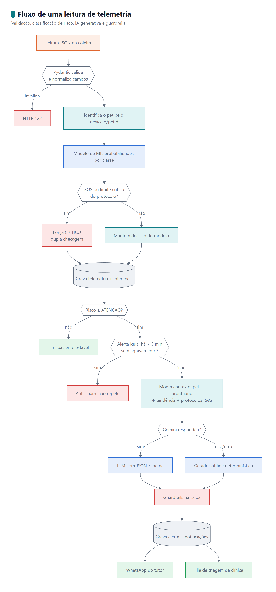
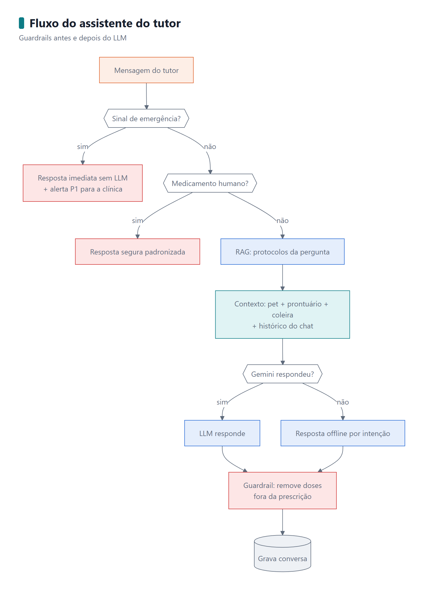
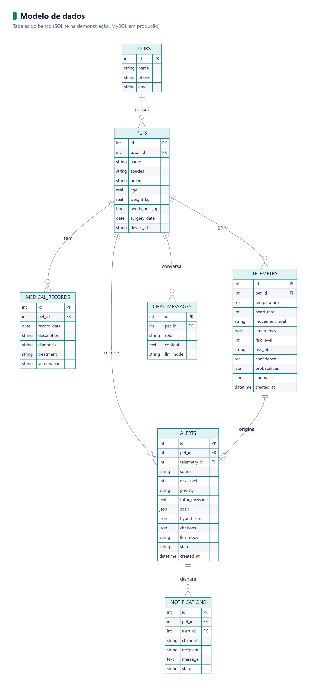

# Arquitetura técnica — CLYVO VET Sprint 4

## 1. Visão em camadas

| Camada | Responsabilidade | Implementação |
| :--- | :--- | :--- |
| **Borda (IoT)** | Ler sensores, classificar risco localmente (LEDs/buzzer) e emitir JSON | `simulation/smart_collar.ino` (Arduino UNO / Wokwi) |
| **Gateway** | Transportar o JSON da coleira para a nuvem | `gateway/serial_bridge.py` (serial/RFC2217/stdin) e `gateway/collar_simulator.py` |
| **API** | Validar, persistir e orquestrar | `app/main.py` (FastAPI), `app/schemas.py` (Pydantic) |
| **IA preditiva** | Classificar risco com probabilidade e explicação | `app/services/risk_model.py` + `clinical_rules.py` |
| **IA generativa** | Escrever alertas, SOAP, respostas do chat e resumos | `copilot.py`, `chat_agent.py`, `llm_client.py` |
| **Conhecimento (RAG)** | Recuperar protocolos clínicos relevantes | `knowledge_base.py` + `ai/data/knowledge/*.md` |
| **Segurança** | Guardrails de entrada e saída, anti-spam, dupla checagem | `guardrails.py`, `pipeline.py`, `risk_model.py` |
| **Persistência** | Pets, prontuário, telemetria, alertas, chat, notificações | `app/database.py` (SQLite) · `database/schema_mysql.sql` |
| **Interface** | Painel da clínica, app do tutor e simulador | `frontend/` (HTML/CSS/JS servido pela própria API) |

## 2. Fluxo de uma leitura de telemetria

  

## 3. Fluxo do assistente do tutor

  

## 4. Modelo de dados

  

## 5. Decisões de projeto

| Decisão | Motivo |
| :--- | :--- |
| **IA híbrida: ML decide o nível, LLM escreve** | Números vitais pedem uma decisão determinística, rápida e auditável; o LLM entra onde agrega valor (linguagem, contexto, personalização) e nunca decide sozinho se o paciente é crítico. |
| **Dupla checagem clínica** | Em saúde, um falso negativo crítico custa mais que um falso positivo. O protocolo garante que limites críticos nunca sejam rebaixados pelo modelo. |
| **RAG com citações `[Kn]`** | Ancora o LLM em protocolos da clínica, reduz alucinação e permite que o veterinário confira a fonte. |
| **Saída estruturada (JSON Schema)** | O painel consome campos (`soap.plano`, `hipoteses`) sem parsing frágil de texto livre. |
| **Guardrails antes e depois do LLM** | Emergências não podem depender de latência ou disponibilidade da API; doses inventadas não podem chegar ao tutor. |
| **Contingência offline com o mesmo contrato** | Se o Gemini falhar ou a cota gratuita acabar, a clínica não fica sem alerta; os testes rodam sem chave. |
| **Anti-spam com exceção por agravamento** | Evita fadiga de alertas sem esconder pioras do quadro. |
| **SQLite + schema MySQL** | Executa com zero configuração para a avaliação; o schema de produção mantém a compatibilidade com o ecossistema MySQL da CLYVO VET. |
| **Frontend sem build** | Avaliadores abrem o painel direto pela API, sem Node.js. |

## 6. Configuração (`.env`)

| Variável | Padrão | Descrição |
| :--- | :--- | :--- |
| `GEMINI_API_KEY` | — | Chave gratuita do Google AI Studio (**obrigatória** no modo `gemini`) |
| `CLYVO_LLM_PROVIDER` | `gemini` | `gemini` ou `offline` (só para testes) |
| `CLYVO_LLM_MODEL` | `gemini-flash-latest` | Modelo do Gemini |
| `CLYVO_ALERT_COOLDOWN_MIN` | `5` | Janela do anti-spam (minutos) |
| `CLYVO_DB_PATH` | `database/clyvo.db` | Caminho do banco SQLite |
